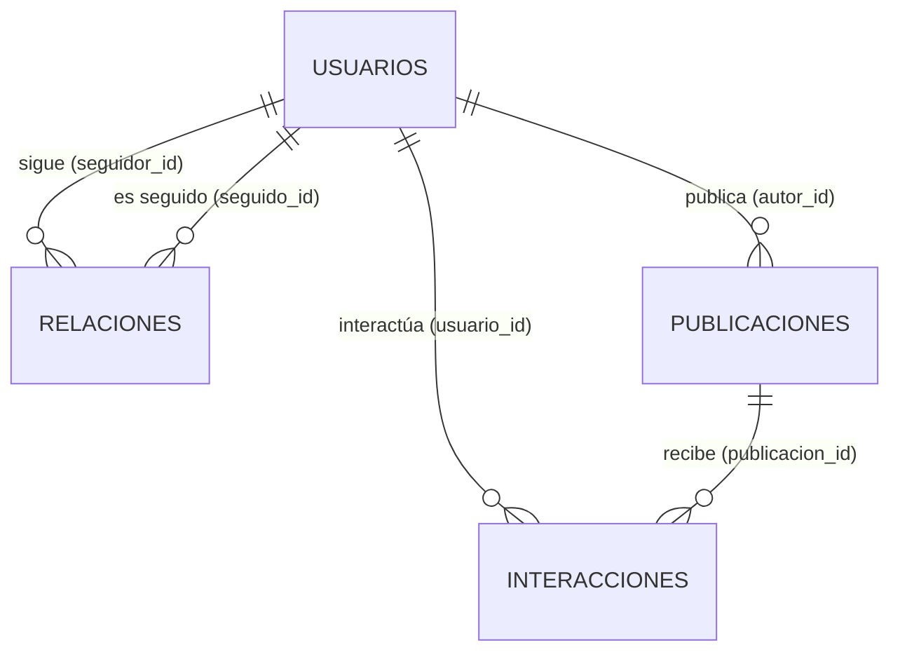

# Diccionario de datos — `data/raw/`

Documento de diagnóstico. Describe **lo observado** en los CSV crudos del lote inicial. No contiene
transformaciones, scores ni rankings. Las descripciones marcadas como **(oficial)** provienen de
`data/raw/diccionario_datos.csv`; las marcadas como **(inferida)** son interpretación del arquitecto y
deben confirmarse.

Convenciones de tipo aparente: `id` (clave texto con patrón), `texto`, `categoría` (dominio cerrado
pequeño), `fecha` (ISO `YYYY-MM-DD`, sin hora ni zona horaria), `decimal`, `entero`, `booleano`.

---

## 1. Inventario de archivos

| Archivo | Filas | Columnas | Bytes | Granularidad (una fila =) | Clave primaria | Codificación |
|---|---:|---:|---:|---|---|---|
| `usuarios.csv` | 650 | 11 | 89 665 | un perfil | `usuario_id` | UTF-8 sin BOM, LF |
| `relaciones.csv` | 8 133 | 3 | 219 632 | una arista dirigida "A sigue a B" | (`seguidor_id`, `seguido_id`) | ASCII, LF |
| `publicaciones.csv` | 5 200 | 7 | 286 566 | una publicación | `publicacion_id` | UTF-8 sin BOM, LF |
| `interacciones.csv` | 35 810 | 5 | 1 774 224 | un evento de interacción usuario→publicación | `interaccion_id` | ASCII, LF |
| `diccionario_datos.csv` | 7 | 3 | 468 | una descripción de campo (metadato) | (`archivo`, `campo`) | UTF-8 sin BOM, LF |

Separador `,`; cabecera en la primera fila; campos con coma van entre comillas dobles (p. ej. 212
valores de `organizacion`). Ningún archivo tiene celdas vacías ni filas duplicadas completas.

### Huellas SHA-256 del lote inicial (línea base de inmutabilidad)

```
693b468c30fb941f03161a34d8cfdcc61091339f63d947477974eed6ce9fd772  data/raw/diccionario_datos.csv
ae234e72572030017f2e85a08d9bee98089da78d59b76726d4cc4c7ce3fc0209  data/raw/interacciones.csv
05014e6ce0ee24b0d1a3c57c7de1d7de7170f0b6615d582f1ae52b69a584da59  data/raw/publicaciones.csv
eb03d660d33bb02d2a9e6d71170fb102779af081ec8b3c17c7c166248eb654c8  data/raw/relaciones.csv
8fc432955f431ec31865049a4757116819bfc050b78bb2de6556642e59a5c737  data/raw/usuarios.csv
```

Verificación: `sha256sum -c` contra este bloque debe dar `OK` en todos los archivos antes de cada corrida.

---

## 2. Diccionario por archivo

### 2.1 `usuarios.csv` — perfiles (dimensión)

| Columna | Tipo aparente | Ejemplo | Vacíos | Únicos | Dominio / rango observado | Descripción |
|---|---|---|---:|---:|---|---|
| `usuario_id` | id | `USR0001` | 0 | 650 | `USR0001`–`USR0650`, contiguo, patrón `USR\d{4}` | Clave sintética del perfil **(oficial)** |
| `usuario` | texto | `raquelziemannd0001` | 0 | 650 | 11–18 caracteres; los 4 últimos dígitos = dígitos de `usuario_id` (100 %) | Handle / nombre de usuario **(inferida)** |
| `nombre` | texto | `Raquel Ziemann DDS` | 0 | 650 | Nombres sintéticos en inglés; 208 con tratamiento o sufijo (`Dr.`, `Mrs.`, `DDS`, `III`…) | Nombre visible **(inferida)** |
| `ocupacion` | texto | `Oceanographer` | 0 | 416 | Texto libre en inglés; máx. 4 repeticiones por valor | Ocupación declarada **(inferida)** |
| `organizacion` | texto | `Price, Senger and Reinger` | 0 | 643 | Texto libre; 212 contienen coma (entrecomillados) | Organización **(inferida)** |
| `pais` | categoría | `Bolivia` | 0 | 5 | Bolivia 264 · Perú 111 · Colombia 95 · Argentina 90 · Chile 90 | País del perfil **(inferida)** |
| `nicho` | categoría | `Gastronomía` | 0 | 6 | Gastronomía 123 · Viajes 115 · Educación 111 · Moda 108 · Deportes 98 · Tecnología 95 | Temática principal del perfil **(inferida)** |
| `fecha_registro` | fecha | `2024-02-18` | 0 | 571 | 2018-01-05 → 2026-06-23 | Alta del perfil **(inferida)** — ver Q01 |
| `latitud` | decimal | `11.81229` | 0 | 650 | −89.64 → 89.80 (5 decimales) | Coordenada **(inferida)** — ver Q05 |
| `longitud` | decimal | `10.83439` | 0 | 650 | −179.73 → 178.87 | Coordenada **(inferida)** — ver Q05 |
| `verificado` | booleano | `TRUE` | 0 | 2 | `TRUE` 151 (23,2 %) · `FALSE` 499 | Indicador **ficticio** de verificación **(oficial)** — ver Q07 |

### 2.2 `relaciones.csv` — grafo de seguimiento (hecho / aristas)

| Columna | Tipo aparente | Ejemplo | Vacíos | Únicos | Dominio / rango observado | Descripción |
|---|---|---|---:|---:|---|---|
| `seguidor_id` | id (FK → `usuarios.usuario_id`) | `USR0001` | 0 | 650 | Todos los perfiles siguen a alguien | Perfil que inicia la relación **(oficial)** |
| `seguido_id` | id (FK → `usuarios.usuario_id`) | `USR0605` | 0 | 650 | Todos los perfiles tienen ≥ 1 seguidor | Perfil que recibe la relación **(oficial)** |
| `fecha_seguimiento` | fecha | `2024-10-06` | 0 | 1 685 | 2022-01-01 → 2026-08-28 | Fecha en que se creó el seguimiento **(inferida)** |

Perfil del grafo (observado): 650 nodos, 8 133 aristas dirigidas, sin auto-seguimientos, sin pares
repetidos. Grado de salida (seguidos) 2–27, media 12,5. Grado de entrada (seguidores) 1–39, media 12,5,
mediana 11. Aristas recíprocas: 212 (106 pares mutuos, 2,6 % de las aristas); 178 perfiles tienen al
menos un mutuo, 472 ninguno. El archivo viene ordenado por `seguidor_id`.

### 2.3 `publicaciones.csv` — contenido (hecho)

| Columna | Tipo aparente | Ejemplo | Vacíos | Únicos | Dominio / rango observado | Descripción |
|---|---|---|---:|---:|---|---|
| `publicacion_id` | id | `PUB000001` | 0 | 5 200 | `PUB000001`–`PUB005200`, contiguo | Clave de la publicación **(inferida)** |
| `autor_id` | id (FK → `usuarios.usuario_id`) | `USR0137` | 0 | 646 | 1–25 publicaciones por autor (media 8,0); 4 perfiles sin publicaciones: `USR0197`, `USR0229`, `USR0612`, `USR0626` | Perfil autor **(inferida)** |
| `fecha_publicacion` | fecha | `2025-02-19` | 0 | 626 | 2024-01-01 → 2025-09-17 (3 000 en 2024, 2 200 en 2025) | Fecha de publicación **(inferida)** |
| `tipo_contenido` | categoría | `Video` | 0 | 4 | Video 1 789 · Imagen 1 687 · Texto 969 · Historia 755 | Formato **(inferida)** |
| `tema` | categoría | `Educación` | 0 | 6 | Mismo dominio que `usuarios.nicho`; coincide con el nicho del autor en el 81,9 % | Temática de la publicación **(inferida)** |
| `calidad_contenido` | decimal [0,1] | `0.656` | 0 | 720 | 0,033 → 0,978; media 0,463; mediana 0,462 | Señal **simulada** entre 0 y 1 **(oficial)** — ver Q09 |
| `impresiones` | entero ≥ 0 | `556` | 0 | 1 335 | 20 → 7 336; mediana 299; p95 1 439; fuerte asimetría a la derecha | Exposición **simulada** de la publicación **(oficial)** — ver Q08 |

### 2.4 `interacciones.csv` — eventos de engagement (hecho)

| Columna | Tipo aparente | Ejemplo | Vacíos | Únicos | Dominio / rango observado | Descripción |
|---|---|---|---:|---:|---|---|
| `interaccion_id` | id | `INT0000001` | 0 | 35 810 | `INT0000001`–`INT0035810`, contiguo | Clave del evento **(inferida)** |
| `usuario_id` | id (FK → `usuarios.usuario_id`) | `USR0152` | 0 | 650 | 10–106 interacciones por perfil (media 55,1) | Perfil que interactúa **(inferida)** |
| `publicacion_id` | id (FK → `publicaciones.publicacion_id`) | `PUB004027` | 0 | 5 082 | 118 publicaciones sin interacciones | Publicación objetivo **(inferida)** |
| `tipo_interaccion` | categoría | `Me_gusta` | 0 | 4 | Me_gusta 23 121 (64,6 %) · Comentario 6 016 (16,8 %) · Compartido 3 713 (10,4 %) · Guardado 2 960 (8,3 %) | "Me gusta, comentario, compartido o guardado" **(oficial)** — valor real con guion bajo `Me_gusta` |
| `fecha_interaccion` | fecha | `2024-03-28` | 0 | 640 | 2024-01-01 → 2025-10-01; siempre 0–14 días después de la publicación (mediana 7) | Fecha del evento **(inferida)** |

### 2.5 `diccionario_datos.csv` — metadatos

| Columna | Tipo aparente | Ejemplo | Descripción |
|---|---|---|---|
| `archivo` | categoría | `usuarios.csv` | Archivo descrito |
| `campo` | texto | `verificado` | Columna descrita |
| `descripcion` | texto | `Indicador ficticio de verificación` | Descripción oficial |

Cubre solo **7 de 26** columnas de datos (ver Q10). No es una tabla analítica: se usa como fuente de
descripciones oficiales para este documento.

---

## 3. Claves y relaciones



| Relación | Cardinalidad | Integridad referencial observada |
|---|---|---|
| `relaciones.seguidor_id` → `usuarios.usuario_id` | N:1 | 100 % (0 huérfanos) |
| `relaciones.seguido_id` → `usuarios.usuario_id` | N:1 | 100 % |
| `publicaciones.autor_id` → `usuarios.usuario_id` | N:1 | 100 % |
| `interacciones.usuario_id` → `usuarios.usuario_id` | N:1 | 100 % |
| `interacciones.publicacion_id` → `publicaciones.publicacion_id` | N:1 | 100 % |

Relaciones derivables (no explícitas en los datos):

- **Interacción usuario → autor**: `interacciones ⋈ publicaciones` da aristas ponderadas "A interactúa con
  contenido de B" (33 557 pares dirigidos distintos; 3 140 de ellos con interacción en ambos sentidos).
- **Reciprocidad de seguimiento**: autounión de `relaciones` con (`seguido_id`, `seguidor_id`).
- **Interacción de un seguidor**: cruce de interacción usuario→autor con `relaciones`. Solo 838 interacciones
  (2,3 %) provienen de un seguidor del autor; solo 773 de 8 133 aristas (9,5 %) tienen alguna interacción.
- Sin interacciones a contenido propio (0 auto-interacciones).
- Clave natural alternativa en interacciones: (`usuario_id`, `publicacion_id`, `tipo_interaccion`) es única;
  (`usuario_id`, `publicacion_id`) se repite en 166 casos (dos tipos distintos sobre la misma publicación, válido).

---

## 4. Cobertura temporal

| Fuente | Desde | Hasta | Observación |
|---|---|---|---|
| `usuarios.fecha_registro` | 2018-01-05 | 2026-06-23 | 65 perfiles se registran después del último evento de contenido (2025-10-01) |
| `relaciones.fecha_seguimiento` | 2022-01-01 | 2026-08-28 | 3 477 aristas (42,8 %) antes de 2024; 1 573 (19,3 %) después de 2025-10-01 |
| `publicaciones.fecha_publicacion` | 2024-01-01 | 2025-09-17 | ~250 publicaciones/mes; 117 publicaciones en los últimos 14 días del rango |
| `interacciones.fecha_interaccion` | 2024-01-01 | 2025-10-01 | ~1 800/mes; septiembre 2025 parcial (1 312) y octubre 2025 con 6 eventos (cola) |

Las ventanas **no están alineadas**: el contenido cubre 2024-01 → 2025-10 y el grafo 2022-01 → 2026-08.
Hace falta una **fecha de corte** explícita (ver decisiones pendientes en el plan).

---

## 5. Problemas de calidad y hallazgos

Severidad: **Alta** = puede invalidar una métrica si no se trata; **Media** = sesga o limita la
interpretación; **Baja** = cosmético o de documentación.

| ID | Severidad | Hallazgo (observado) | Impacto | Tratamiento propuesto (pendiente de aprobación) |
|---|---|---|---|---|
| Q01 | Alta | Actividad anterior a `fecha_registro`: 3 687 seguimientos (45,3 %) involucran a un perfil aún no registrado; 1 098 publicaciones (21,1 %) anteriores al registro del autor; 7 359 interacciones (20,6 %) anteriores al registro del usuario; 361 perfiles (55,5 %) con alguna actividad previa a su alta. | `fecha_registro` no es fiable para antigüedad ni para validar eventos. | No descartar eventos. Marcar con `flag_previo_registro`; no usar `fecha_registro` en scores salvo decisión explícita. |
| Q02 | Alta | Ventanas temporales desalineadas (sección 4). | Métricas de grafo y de contenido referidas a periodos distintos. | Definir `fecha_corte` y filtrar todo evento `<= fecha_corte` en cada corrida. |
| Q03 | Alta | Las interacciones están casi desacopladas del grafo: 2,3 % de interacciones vienen de seguidores del autor; 9,5 % de aristas tienen alguna interacción. | "Seguidor activo con la cuenta que sigue" será una señal escasa. | Medir valor de seguidor con actividad global además de actividad dirigida; documentar la escasez. |
| Q04 | Media | Reciprocidad de seguimiento baja: 106 pares mutuos; 472 perfiles (72,6 %) sin ningún mutuo. | Baja capacidad discriminante de la reciprocidad de seguimiento. | Complementar con reciprocidad de interacción (3 140 pares dirigidos recíprocos). |
| Q05 | Media | `latitud`/`longitud` cubren todo el planeta dentro de cada país (p. ej. Argentina lat −89,5 → 88,2). | Coordenadas incoherentes con `pais`; no aptas para análisis geográfico. | Excluir de análisis; usar solo `pais`. |
| Q06 | Media | Publicaciones `Historia` reciben interacciones hasta 14 días después (87 % a más de 1 día). Distribución de retraso idéntica en los 4 formatos. | Contradice la semántica efímera de una historia; sugiere generación sintética uniforme. | Tratar `Historia` como un formato más; registrar como supuesto. |
| Q07 | Media | `verificado` es **ficticio** (oficial) y está muy asociado a la influencia: correlación 0,65 con seguidores; impresiones medias por publicación 873 (verificados) vs 349. Los 10 perfiles con más seguidores están verificados. | Riesgo de circularidad o de reforzar una etiqueta ficticia si entra al score. | Excluir del score; usarlo solo como variable de contraste/validación. |
| Q08 | Media | `impresiones` es **simulada** y sin definición operativa (¿únicas o totales? ¿acumuladas a qué fecha?). Siempre ≥ nº de interacciones. | Tasas de engagement dependen de su definición. | Usar como alcance relativo; documentar supuesto "impresiones acumuladas totales a la fecha de extracción". |
| Q09 | Media | `calidad_contenido` es **simulada**, de origen desconocido; correlación 0,61 entre calidad media del autor y nº de seguidores. | Puede ser una variable "oráculo" de la simulación. | Usar como componente separado y opcional; evaluar sensibilidad con y sin ella. |
| Q10 | Baja | `diccionario_datos.csv` documenta 7 de 26 columnas; la descripción de `tipo_interaccion` usa "Me gusta" y el dato real `Me_gusta`. | Semántica inferida en 19 columnas. | Confirmar descripciones inferidas con el proveedor de datos. |
| Q11 | Media | No hay eventos de "dejar de seguir" ni estado de la relación; no se sabe si `relaciones.csv` es una foto (snapshot) o un log acumulado. | Afecta cómo integrar nuevos lotes y medir crecimiento neto. | Pregunta abierta; por defecto tratar como snapshot acumulado sin bajas. |
| Q12 | Baja | Sesgo de composición: Bolivia = 40,6 % de los perfiles. | Rankings agregados por país desbalanceados. | Reportar rankings también normalizados/por segmento. |
| Q13 | Baja | 4 perfiles sin publicaciones y 118 publicaciones sin interacciones. | Ceros legítimos, no faltantes. | Mantener con valor 0 (no imputar). |
| Q14 | Baja | 166 pares (usuario, publicación) con dos interacciones de tipo distinto. | Doble conteo si se cuentan "usuarios que interactúan" sin `nunique`. | Contar eventos y usuarios únicos por separado. |
| Q15 | Media | Censura de borde: interacciones solo 0–14 días tras publicar; 117 publicaciones en los últimos 14 días del rango y meses finales parciales (2025-09, 2025-10). | Publicaciones recientes parecen peores de lo que son. | Excluir de métricas de engagement las publicaciones con menos de 14 días respecto a `fecha_corte`, o normalizar por ventana. |
| Q16 | Baja | Campos de texto mezclan idiomas (`ocupacion`, `nombre` en inglés; categorías en español) y los nombres incluyen tratamientos/sufijos. | Solo presentación. | No normalizar; son atributos descriptivos. |
| Q17 | Baja | Datos personales sintéticos (`nombre`, `organizacion`, coordenadas). | Si en el futuro llegan datos reales, aplican reglas de privacidad. | Minimizar PII en salidas: publicar `usuario_id`/`usuario`, no `nombre` ni coordenadas. |

Comprobaciones superadas (sin incidencias): sin celdas vacías; sin filas duplicadas; claves primarias
únicas; IDs con patrón consistente y contiguos; integridad referencial 100 %; fechas válidas y no
futuras respecto al 2026-11-11; `calidad_contenido` dentro de [0,1]; `impresiones` > 0; sin
auto-seguimientos ni auto-interacciones; ninguna interacción anterior a su publicación.

---

## 6. Información faltante para los objetivos de negocio

| Falta | Afecta a | Consecuencia |
|---|---|---|
| Recuento oficial de seguidores por fecha (series) | Crecimiento, influencia | Solo se reconstruye desde las aristas, sin bajas |
| Eventos de dejar de seguir | Reciprocidad, crecimiento neto | Se asume que toda arista sigue vigente |
| Definición de `impresiones` y de `calidad_contenido` | Alcance, engagement, calidad | Se usan como señales relativas |
| Hora y zona horaria de los eventos | Análisis intradía | Granularidad diaria |
| Texto de comentarios / sentimiento | Calidad de la interacción | No medible |
| Alcance de compartidos (impresiones secundarias) | Amplificación | Se mide solo el conteo de compartidos |
| Frecuencia y forma de llegada de nuevos datos (delta vs snapshot) | Estrategia incremental | Ver plan, decisiones pendientes |

---

## 7. Supuestos de trabajo (a validar)

- S1. Todos los datos son **sintéticos**; los hallazgos describen el conjunto, no un mercado real.
- S2. Cada arista de `relaciones.csv` está vigente a la fecha de extracción.
- S3. `impresiones` son acumuladas totales por publicación a la fecha de extracción.
- S4. Las fechas son días calendario sin zona horaria.
- S5. `tipo_interaccion` tiene distinto esfuerzo/valor (Me_gusta < Guardado < Comentario < Compartido); los pesos concretos son una decisión de negocio pendiente.
- S6. `fecha_registro` es poco fiable (Q01) y no se usa como filtro de validez.

## 8. Historial de este documento

| Fecha | Cambio |
|---|---|
| 2026-11-11 | Versión inicial a partir del perfilado del lote L0000. |
