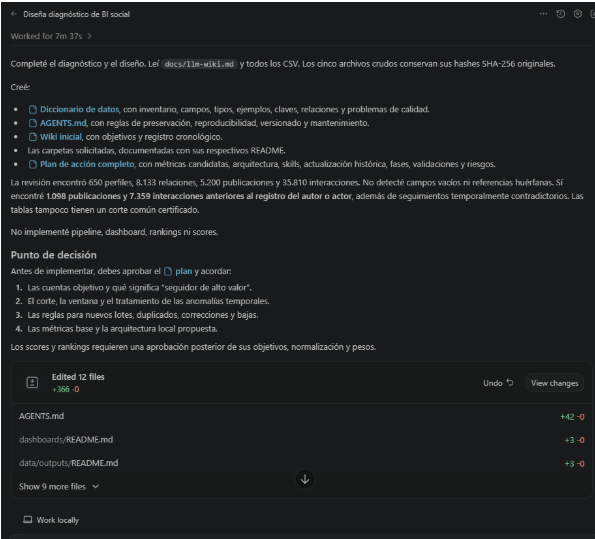
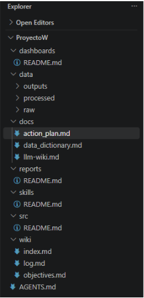

# 1. Qué se compara

| Versión | Herramienta | Cómo se obtuvo | Evidencia disponible |
|---|---|---|---|
| **A · Profesor** | Codex (OpenAI) en VS Code | Prompt propuesto de U3-T3 | Solo 2 capturas: el resumen final y el explorador de archivos |
| **B · Nuestro U3-T3** | Claude Code (Opus 5.5) | Agente nuevo, prompt literal **más un preámbulo mío** (usar uv, no hacer commits y "entregar el plan completo en el mensaje final") | Todos los archivos. Commit `2736122` en la rama `main` |
| **C · Re-ejecución (experimento)** | Claude Code (Opus 5.5) | Agente nuevo, prompt literal con **una sola línea de contexto** (carpeta y uv), desde el mismo estado inicial que B | Todos los archivos. Commit `8f662e2` en la rama `experimento-u3t4` |

La versión C no la pedía la tarea. La hice para responder con evidencia a la pregunta 2: ¿qué
diferencias se deben a la herramienta y cuáles a cómo se dio el prompt? Repositorio:
<https://github.com/dq-datasci/ProyectoWiki-Influencers>.

**Limitación importante.** Del profesor solo tengo dos capturas. Veo su mensaje final y su árbol de
carpetas, pero no el contenido de su `data_dictionary.md`, `AGENTS.md` ni `action_plan.md`. Todo lo
que digo sobre la profundidad de su trabajo es inferencia a partir de esas capturas y del contador
"Edited 12 files +366 −0".

{width=62%}

{width=26%}

# 2. Contraste lado a lado

| Aspecto | A · Profesor (Codex) | B · U3-T3 (Claude + preámbulo) | C · Re-ejecución (Claude, sin preámbulo) |
|---|---|---|---|
| Tiempo de trabajo | 7 min 37 s | ~6 min | ~6 min |
| Archivos creados | 12 (+366 líneas) | 5 con contenido (452 líneas) + 12 `.gitkeep` | 6 con contenido (611 líneas) + 10 `.gitkeep` |
| Tamaño de `AGENTS.md` | **42 líneas** | 130 líneas | 120 líneas |
| **Dónde queda el plan** | **Archivo `docs/action_plan.md`**, enlazado desde el chat | **Solo en el chat** (217 líneas); yo lo guardé después en `entrega/` | **Archivo `wiki/plan-accion.md`** (201 líneas) + resumen en el chat |
| Carpetas vacías | **`README.md` en cada una** (6), que explica su propósito | `.gitkeep` | `.gitkeep` |
| Subcarpetas extra en `wiki/` | Ninguna | 6 (`sources`, `metrics`, `quality`, `decisions`, `runs`, `entities`) | 4 (`fuentes`, `metricas`, `hallazgos`, `decisiones`) |
| Cifras base (650 / 8 133 / 5 200 / 35 810) | ✓ | ✓ | ✓ |
| Sin vacíos y sin claves huérfanas | ✓ | ✓ | ✓ |
| 1 098 publicaciones y 7 359 interacciones anteriores al registro | ✓ | ✓ | ✓ |
| Seguimientos con fechas contradictorias | ✓ (sin cifra en el resumen) | ✓ 3 687 (45 %) | ✓ 3 687 (45 %) |
| Ventanas de tiempo sin un corte común | ✓ "sin corte común certificado" | ✓ (Q02) | ✓ |
| Otros hallazgos cuantificados | No visibles en las capturas | 17 problemas (Q01–Q17). Ej.: solo el 2,3 % de las interacciones viene de seguidores | 11 problemas + 7 observaciones. Mismo 2,3 % |
| Hashes de `data/raw/` verificados | ✓ SHA-256 | ✓ SHA-256 | ✓ SHA-256 |
| No implementó pipeline, scores ni rankings | ✓ | ✓ | ✓ |
| **Punto de decisión** | **4 decisiones de negocio**. Pesos y normalización van en una aprobación posterior | **11 decisiones técnicas** (D01–D11), con valores propuestos (pesos 1/2/3/4, corte 2025-10-01…) | **13 decisiones** (D1–D13), con valores por defecto. Indica cuáles hacen falta antes de F1 |
| Mensaje final en el chat | Breve (~15 líneas) con enlaces | Plan completo (~217 líneas) | Resumen largo (~80 líneas) |
| Entorno y versionado | No se ve `pyproject.toml`, `.venv` ni git en la captura | uv + git + GitHub | uv + git (rama aparte) |

# 3. ¿Qué observaciones y conclusiones se pueden sacar?

## Observaciones

**1. El diagnóstico de los datos converge; la forma diverge.** Las tres ejecuciones, con dos
herramientas y dos modelos distintos, llegan a **las mismas cifras exactas**:

- 650 perfiles, 8 133 relaciones, 5 200 publicaciones y 35 810 interacciones;
- 0 vacíos y 0 claves huérfanas;
- 1 098 publicaciones y 7 359 interacciones anteriores al registro.

Los hechos observables son reproducibles porque el agente los calcula con código y no los
"opina". Lo que cambia entre ejecuciones es todo lo que el prompt **no especifica**: dónde guardar el
plan, cómo documentar las carpetas, cuántas subcarpetas crear, cuán detallado ser y cuántas decisiones
pedir.

**2. El preámbulo que añadí en U3-T3 explica una diferencia, pero no las demás.** El experimento C
lo confirma:

- **Lo explicaba el preámbulo:** que el plan quedara solo en el chat. Sin el preámbulo, Claude también
  guardó el plan como archivo (`wiki/plan-accion.md`), igual que Codex (`docs/action_plan.md`).
- **No lo explicaba el preámbulo**, porque C se parece más a B que a A:
  - el volumen: Claude escribe 2 a 3 veces más (`AGENTS.md` de 120–130 líneas frente a 42);
  - el uso de `.gitkeep` en lugar de README;
  - las subcarpetas extra de la wiki;
  - el detalle del Punto de decisión (11–13 ítems frente a 4).

  Es decir, son **rasgos de estilo de cada herramienta o modelo**.

**3. Aun con la misma herramienta y el mismo prompt, el resultado no es idéntico.** B y C son el
mismo modelo, con prompts casi iguales y partiendo del mismo estado, y aun así cambian:

- los nombres de las subcarpetas de la wiki (en inglés en B, en español en C);
- el número de decisiones (11 frente a 13);
- la numeración de los problemas de calidad (Q01–Q17 frente a Q1–Q11);
- dónde va el plan.

Un agente de IA es **no determinista en la forma**. Si se quiere un resultado concreto, hay que pedirlo
explícitamente.

**4. Dos estilos de "arquitecto".**

- **Codex (A)** actúa como un consultor que entrega a un cliente. Es conciso, deja la estructura
  autodocumentada (un README por carpeta) y plantea el Punto de decisión en lenguaje de negocio: qué
  cuentas, qué es "alto valor", qué corte, qué reglas para lotes. Además deja los pesos y la
  normalización **para una segunda aprobación**, lo que respeta la consigna de no avanzar a los
  scores.
- **Claude (B y C)** actúa como un ingeniero de datos que prepara la implementación. Cuantifica cada
  hallazgo, propone valores concretos (pesos, percentiles, top-N, fecha de corte) y diseña más
  estructura de la que se pidió. Es más útil para ejecutar, pero adelanta decisiones que le
  corresponden al usuario y aumenta la complejidad.

**5. Ambos persisten el conocimiento, como pide el patrón LLM Wiki.** Cuando no se le impide, el
agente guarda el plan como archivo. Esto es coherente con `llm-wiki.md`: el conocimiento debe vivir en
archivos que se mantienen, no en el historial del chat.

## Conclusiones

1. **El prompt es suficiente para el contenido, pero no para la forma.** Asegura la misma sustancia
   (diagnóstico, restricciones, secciones del plan), pero deja libres decisiones de presentación que
   cada herramienta resuelve a su manera.
2. **Cualquier instrucción adicional cambia el resultado.** Mi preámbulo, pensado solo para lo
   operativo, alteró un aspecto visible: dónde quedaba el plan. En trabajo con agentes, el prompt
   completo (contexto incluido) es parte del diseño.
3. **La herramienta importa tanto como el prompt.** Con el mismo prompt, Codex tiende a la
   concisión y Claude a la exhaustividad.
4. **Las diferencias son de forma, no de corrección.** Las tres versiones cumplen la consigna, no
   tocan `data/raw/` y coinciden en los hechos. Ninguna se equivoca; responden a preferencias de
   diseño distintas.

# 4. ¿Qué sugerir para obtener un resultado más similar al presentado?

Ordenadas de mayor a menor impacto:

| # | Sugerencia | Diferencia que corrige |
|---|---|---|
| 1 | **Usar la misma herramienta y el mismo entorno**: Codex en VS Code, con la carpeta abierta como espacio de trabajo. El prompt pide un `AGENTS.md`, que es la convención nativa de Codex | Estilo general, concisión |
| 2 | **No añadir instrucciones fuera del prompt.** Si hace falta contexto (por ejemplo, usar uv), ponerlo en `AGENTS.md` o en un archivo de configuración, no en el mensaje | Plan solo en el chat (B) |
| 3 | **Decir dónde guardar el plan**: "Guarda el plan de acción en `docs/action_plan.md` y enlázalo en tu respuesta" | Ubicación del plan |
| 4 | **Decir cómo documentar las carpetas**: "Cada carpeta nueva debe tener un `README.md` de 2–3 líneas que explique su propósito; no crees subcarpetas adicionales" | README frente a `.gitkeep`, subcarpetas extra |
| 5 | **Limitar la extensión y el nivel del Punto de decisión**: "Resume el Punto de decisión en un máximo de 4–5 decisiones de negocio. Deja pesos y normalización para una aprobación posterior" | 11–13 decisiones técnicas frente a 4 de negocio |
| 6 | **Limitar la longitud**: "`AGENTS.md` de no más de ~50 líneas; respuesta final breve con enlaces a los archivos" | Volumen 2–3 veces mayor |
| 7 | **Partir del mismo estado inicial**: misma carpeta y mismos archivos previos. Nosotros teníamos `pyproject.toml`, `uv.lock` y git, y el agente los tomó en cuenta | Referencias a uv y git en las reglas |
| 8 | **Ejecutar varias veces y comparar.** Como el agente no es determinista, una sola ejecución no basta para afirmar que algo es "lo que produce la herramienta" | Variación entre ejecuciones (B frente a C) |

En el Anexo A propongo un prompt ajustado que incorpora las sugerencias 3 a 6.

# 5. ¿Cuál es el mejor resultado y por qué?

**Como entregable de esta fase, el del profesor es mejor, aunque por poco. Como base técnica para
implementar, el nuestro es más sólido.**

| Criterio | A · Profesor | B · Nuestro U3-T3 | Mejor |
|---|---|---|---|
| Cumplimiento de la consigna | Completo | Completo | Empate |
| Exactitud del diagnóstico | Mismas cifras | Mismas cifras, verificadas de forma independiente | Empate |
| Profundidad del diagnóstico | No se ve en las capturas | 17 problemas cuantificados, ER, supuestos, faltantes | B (con la salvedad de que no veo el de A) |
| Persistencia del plan (principio de la wiki) | Plan como archivo enlazado | Plan solo en el chat (por mi preámbulo) | **A** |
| Autodocumentación de la estructura | README por carpeta | `.gitkeep` vacíos | **A** |
| Claridad para quien aprueba | 4 decisiones de negocio | 11 decisiones técnicas | **A** |
| Respeto al alcance "solo diseño" | Deja los pesos para después | Ya propone pesos, percentiles y top-N | **A** |
| Proporcionalidad al problema | 366 líneas, estructura mínima | Más estructura de la necesaria (ver informe U3-T3) | **A** |
| Reproducibilidad del entorno | No visible | uv + `uv.lock` + git + GitHub + hashes | **B** |
| Utilidad para pasar a implementar | Necesitará otra ronda de definiciones | Las decisiones ya traen valores por defecto | **B** |

**Por qué A gana como entregable.** La tarea es una fase de **diagnóstico y diseño para
aprobación**. En esa fase el destinatario es una persona que debe decidir, y A le entrega:

- un plan que **persiste** como archivo;
- una estructura que **se explica sola**;
- un Punto de decisión **corto y en lenguaje de negocio**, que no adelanta decisiones técnicas.

Logra lo mismo con aproximadamente la mitad de texto. Ese es el mejor equilibrio entre rigor y
simplicidad.

**Por qué B no es peor en todo.** Su diagnóstico es más profundo y está verificado. Su entorno es
reproducible (uv, lock, git). Sus decisiones vienen con propuestas concretas, lo que acelera la fase
siguiente. Si el objetivo fuera "dejar el proyecto listo para implementar mañana", B sería
preferible.

**Sobre la versión C.** Muestra que Claude, sin mi preámbulo, corrige la principal desventaja de B
(el plan queda como archivo en la wiki). Pero sigue siendo más extensa que A. Una versión C con las
sugerencias 4 a 6 sería, a mi juicio, la mejor de las tres.

# 6. Apreciación personal

Esta comparación me dejó una lección más importante que el propio plan. **Con IA, el resultado
depende del sistema completo: prompt, contexto, herramienta, modelo y estado inicial.** Dos agentes
competentes coincidieron en todo lo verificable y divergieron en todo lo que el prompt dejó abierto.

Por eso un buen prompt de BI asistido debe hacer tres cosas:

- especificar los **hechos** a obtener;
- especificar la **forma** de los entregables: dónde, en qué formato, con qué extensión y para quién;
- dejar las **preferencias** del proyecto en archivos persistentes (`AGENTS.md`), no en mensajes
  sueltos.

Así el resultado deja de depender de la herramienta y se vuelve más reproducible.

# Anexo A · Prompt ajustado para acercarse al resultado del profesor

Estas líneas se añaden al final del prompt original de U3-T3:

```text
Formato de los entregables:
- Guarda el plan de acción completo en docs/action_plan.md y enlázalo en tu respuesta final.
- Cada carpeta nueva (skills/, src/, reports/, dashboards/, data/processed/, data/outputs/) debe
  tener un README.md de 2-3 líneas con su propósito. No crees subcarpetas adicionales.
- AGENTS.md: máximo ~50 líneas, reglas concisas.
- Respuesta final en el chat: breve (máximo ~20 líneas), con enlaces a los archivos creados.
- Punto de decisión: máximo 4-5 decisiones, en lenguaje de negocio. Pesos, normalización y
  umbrales se aprobarán en una etapa posterior: no los propongas aún como valores.
```

# Anexo B · Archivos y reproducibilidad

| Ubicación | Contenido |
|---|---|
| `entrega_U3-T4/INFORME.md` / `.pdf` | Este informe |
| `entrega_U3-T4/capturas/` | Las 2 capturas del resultado del profesor |
| `entrega_U3-T4/ejecucion2_respuesta_chat.md` | Respuesta literal en el chat de la re-ejecución (C) |
| Rama `main`, commit `2736122` | Resultado B (U3-T3); su plan está en `entrega/plan_agente.md` |
| Rama `experimento-u3t4`, commit `8f662e2` | Resultado C; su plan está en `wiki/plan-accion.md` |

Para comparar B y C:

```bash
git clone https://github.com/dq-datasci/ProyectoWiki-Influencers.git && cd ProyectoWiki-Influencers
git diff --stat 2736122 origin/experimento-u3t4 -- AGENTS.md docs wiki
```
